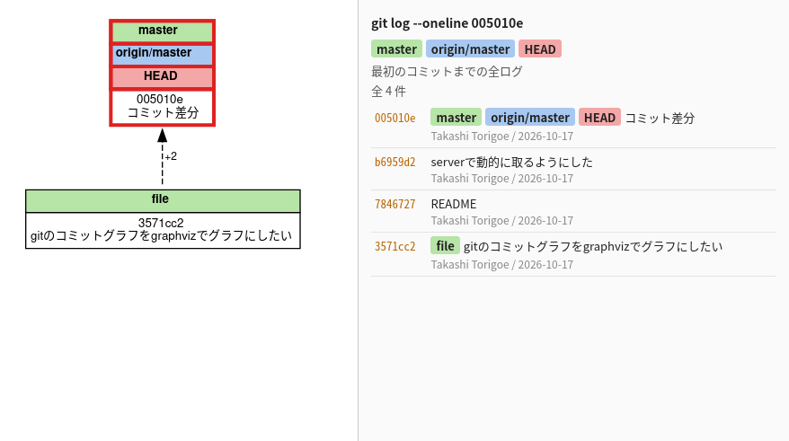
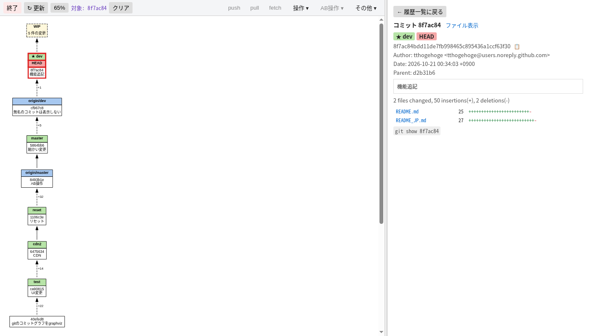
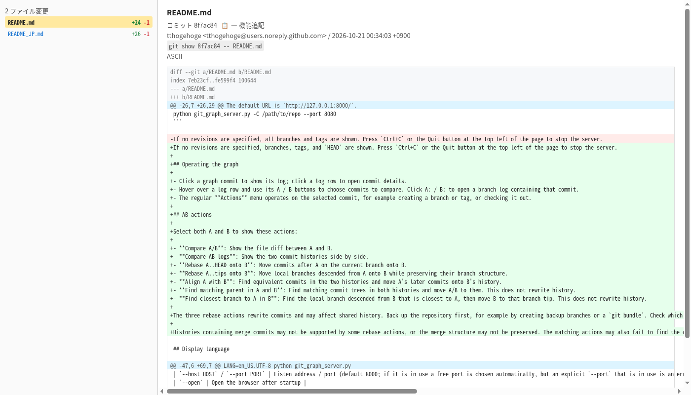
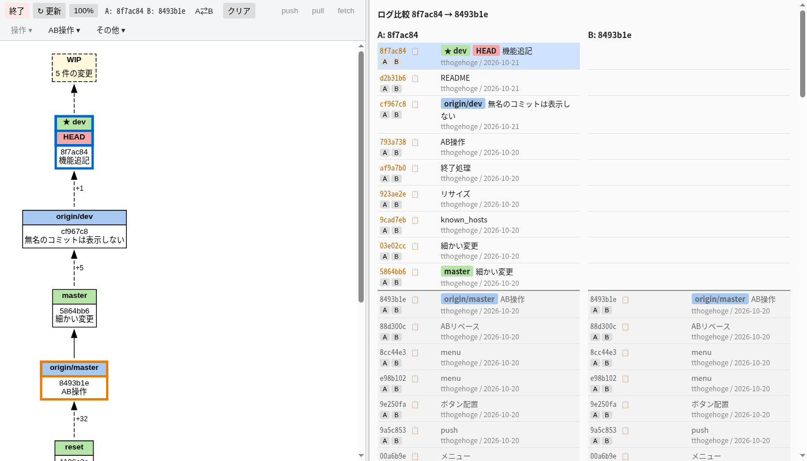

# git_graph_server

[日本語版 README](README_JP.md)

Licensed under the [MIT License](LICENSE).

A Linux-oriented local browser UI for viewing Git commit graphs, logs, diffs, and working-tree changes. It also supports operations such as branch, tag, merge, rebase, and stash management.

## Requirements

Linux is the supported platform.

- Python 3 (standard library only)
- Git
- Graphviz `dot`

Keep `git_graph_server.py` and the `git_graph/` package (Python modules, `static/`, and `locales/`) together when copying or deploying the application. `git_graph_server.py` adds its own directory to `sys.path`, so it also works with the Windows embeddable Python. You can also run `python -m git_graph` from the repository root. API endpoints are registered next to their handlers with the `@route` decorator.

## Usage

```sh
python git_graph_server.py --open
```

The default URL is `http://127.0.0.1:8000/`.

```sh
python git_graph_server.py -C /path/to/repo --port 8080
```

If no revisions are specified, branches, tags, and `HEAD` are shown. Press `Ctrl+C` or the Quit button at the top left of the page to stop the server.

## Operating the graph

- Click a graph commit to show its log; click a log row to open commit details.
- Hover over a log row and use its A / B buttons to choose commits to compare. Click A: / B: to open a branch log containing that commit.
- The regular **Actions** menu operates on the selected commit, for example creating a branch or tag, or checking it out.

## AB actions

Select both A and B to show these actions:

- **Compare A/B**: Show the file diff between A and B.
- **Compare AB logs**: Show the two commit histories side by side.
- **Rebase A..HEAD onto B**: Move commits after A on the current branch onto B.
- **Rebase A..tips onto B**: Move local branches descended from A onto B while preserving their branch structure.
- **Align A with B**: Find equivalent commits in the two histories and move A's later commits onto B's history.
- **Find matching parent in A and B**: Find matching commit trees in both histories and move A/B to them. This does not rewrite history.
- **Find closest branch to A in B**: Find the local branch descended from B that is closest to A, then move B to that branch tip. This does not rewrite history.

The three rebase actions rewrite commits and may affect shared history. Back up the repository first, for example by creating backup branches or a `git bundle`. Check which branches will be affected before rebasing multiple branches.

Histories containing merge commits may not be supported by some rebase actions, or the merge structure may not be preserved. The matching actions may also fail to find the correct equivalent commits in some histories. These features are not guaranteed to work perfectly; review their results and keep a backup before using them on important repositories.

## Display language

Set the language with `LANG` when starting the server. Japanese is used for an unset or unsupported language.

English display is currently incomplete; some labels and messages may still appear in Japanese.

```sh
LANG=ja_JP.UTF-8 python git_graph_server.py
LANG=en_US.UTF-8 python git_graph_server.py
```

## Main options

| Option | Description |
| --- | --- |
| `-C PATH` | Repository path (default: current directory) |
| `--host HOST` / `--port PORT` | Listen address / port (default 8000; if it is in use a free port is chosen automatically, but an explicit `--port` that is in use is an error) |
| `--open` | Open the browser after startup |
| `--no-remotes` / `--no-tags` | Hide remotes / tags |
| `--include-tips` | Include terminal commits without a branch or tag |
| `--no-wip` | Hide the WIP node for uncommitted changes |
| `--no-count` | Skip collapsed-commit counts |
| `--full-layout` | Do not skip Graphviz layout optimization |
| `--read-only` | Disable write operations |
| `--lan` | Allow LAN access and write operations |
| `--dot` | Print dot output and exit |

## Safety

Write operations are enabled only from localhost by default. `--lan` and `--allow-write` accept unauthenticated requests, so use them only on a trusted network.

Operations such as reset, checkout, and dropping a stash may cause data loss. Back up important repositories and review each operation before running it.

## Screenshots





