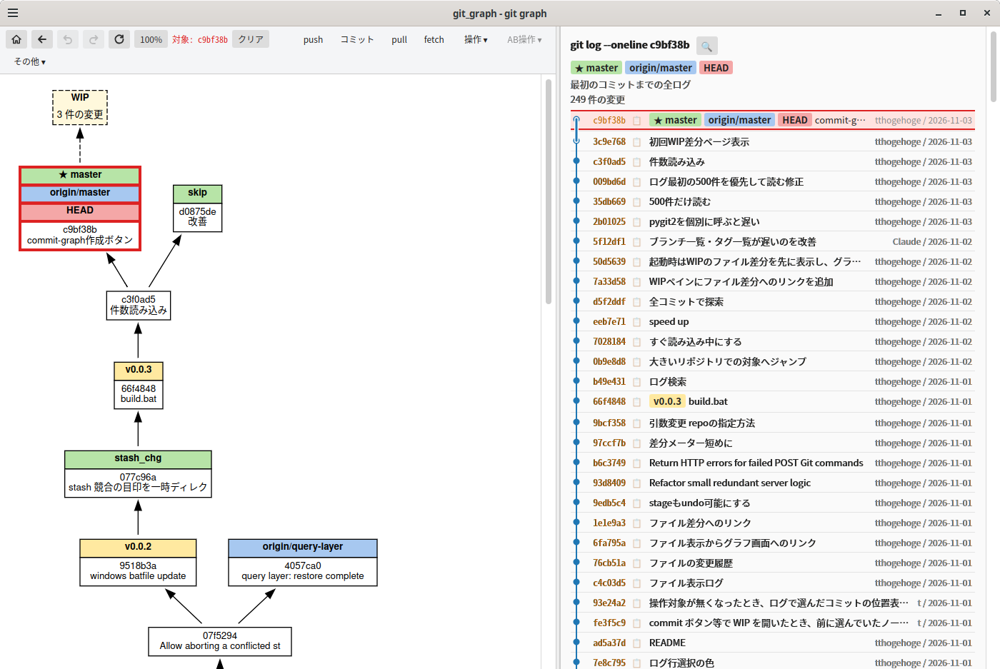
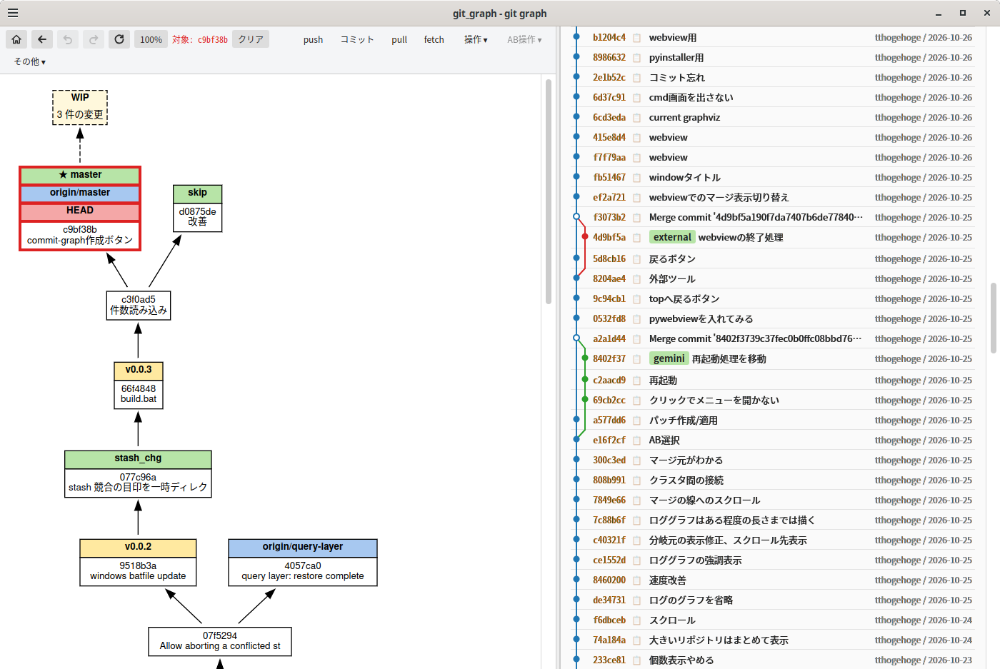
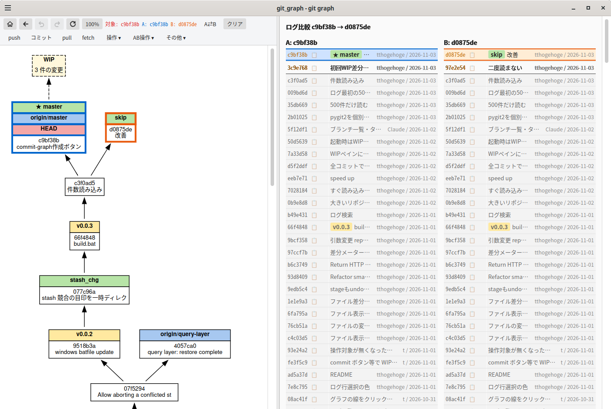
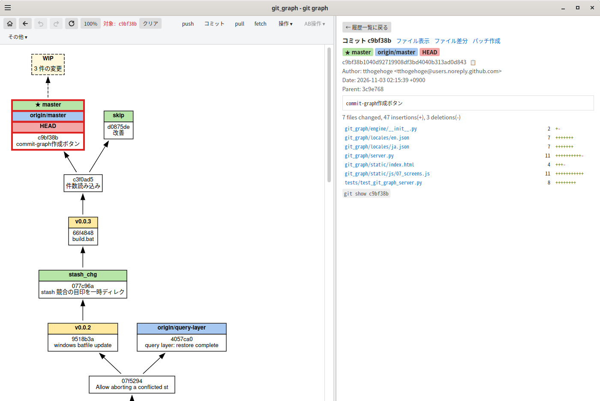
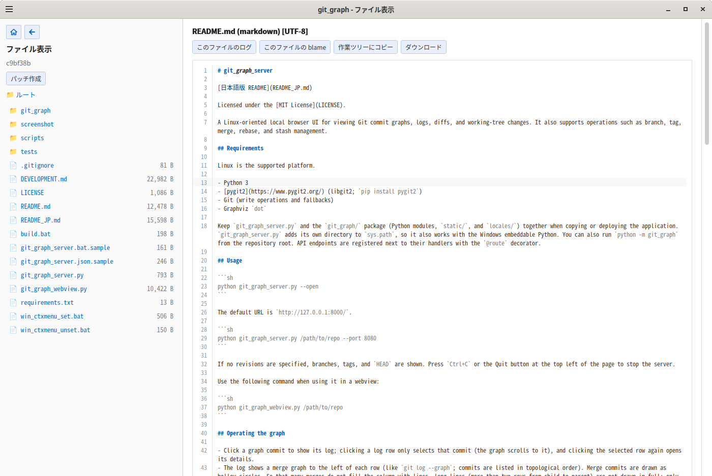
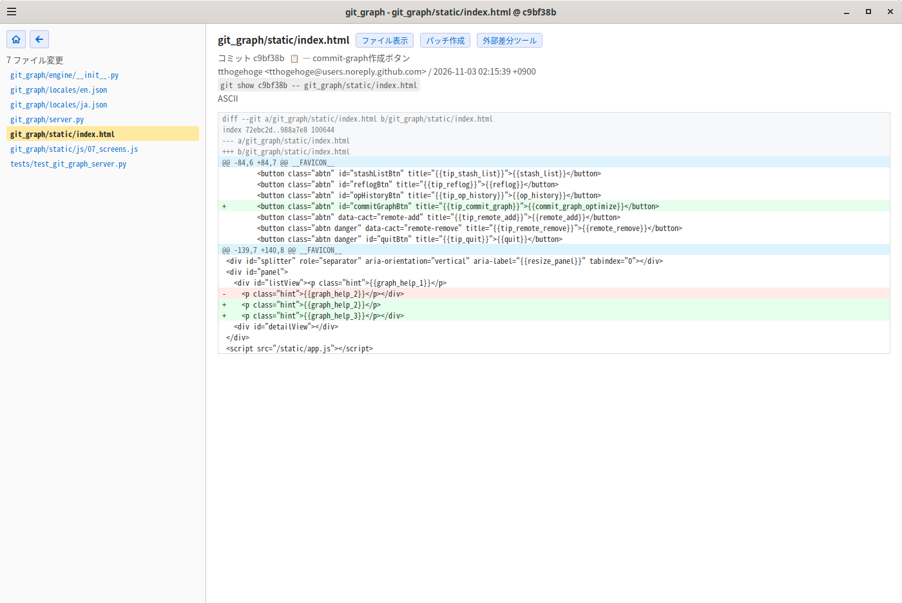

# git_graph_server

ライセンス: [MIT License](LICENSE)
サードパーティのライセンスは [THIRD_PARTY_NOTICES](THIRD_PARTY_NOTICES) を参照。

Linux 向けのローカルサーバーです。Git のコミットグラフ、ログ、差分、作業ツリーの変更をブラウザで確認できます。ブランチ、タグ、merge、rebase、stash などの操作にも対応しています。

## 必要なもの

対応プラットフォームは Linux です。

- Python 3
- [pygit2](https://www.pygit2.org/)（libgit2。`pip install pygit2`）
- Git（書き込み操作とフォールバック）
- Graphviz の `dot`

コピー・配置するときは、`git_graph_server.py` と `git_graph/` パッケージ(Python モジュール、`static/`、`locales/`)をこの構成のまま一緒に置いてください。`git_graph_server.py` は自分のあるディレクトリを `sys.path` に追加するので、Windows の embeddable 版 Python でも動きます。リポジトリのルートで `python -m git_graph` として起動することもできます。API のルートは各ハンドラーの近くで `@route` デコレーターを使って登録します。

## 起動

```sh
python git_graph_server.py --open
```

既定の URL は `http://127.0.0.1:8000/` です。

```sh
python git_graph_server.py /path/to/repo --port 8080
```

対象の rev を指定しない場合は、ブランチ・タグ・HEAD を表示します。終了は `Ctrl+C`、または画面左上の「終了」ボタンです。

webviewで使用する場合は以下のコマンドです。

```sh
python git_graph_webview.py /path/to/repo
```

## 使い方

### 操作について

- グラフのコミットをクリックすると、そのコミットからのログを表示します。ログ行は、1回目のクリックでコミットを選択するだけで(グラフもそのコミットの位置までスクロールします)、選択済みの行をもう一度クリックするとコミットの詳細を開きます。
- ログの各行の左にマージグラフを表示します (`git log --graph` と同様に、トポロジー順に並べます)。マージコミットは白抜きの丸で表します。マージが多くても線で埋まらないように、子から親まで2行を超える長い線は途中を描かず、両端(子の行から下へ、分岐元の行へ上から)の短い線だけで「どこかへ繋がっている」ことを示します。短い線の先には小さな丸を付け、上下のコミットに繋がって見えないようにしています。分岐元に長い線が着くときは、ノードの右横に短い線を櫛の歯のように並べます(縦の線と重ならず、何本着くかが色で分かります)。コミットを選択すると、そのコミットにつながる線(親への線と、子から着く線)は長くても全部、他の線の上に白い縁取り付きで重ねて描くので、他の線と交わっても追えます。選んだ線の両端の短い目印(丸付きの短い線)は、全部描くので消えます(親がまだ読み込まれていなければ、読み込んだ範囲の端まで描きます)。ログ詳細から戻ったときは、ログを読み直さずにそのまま表示します。
- ログの見出しの横にある 🔍 ボタンで、コミットの検索欄を開きます (必要なときだけ表示されます)。ハッシュの前方一致 (16進数で4桁以上)、件名・本文 (空白で区切った語をすべて含むもの。大文字小文字は区別せず、正規表現ではありません)、作者、コミッター (名前またはメールアドレス)、期間 (両端の日を含みます) で検索でき、表示中のログの範囲だけを検索するか、全コミット (全ブランチ・タグ・リモート追跡ブランチ) から検索するかを選べます。Enter または **検索** で実行し、もう一度 🔍 を押す (または **クリア**) と元のログに戻ります。検索結果にはマージグラフを付けません。検索できるのはコミットのログだけで、ブランチ・タグ・stash・reflog の一覧では使えません。
- グラフを更新(再取得)しても、選択中のノード/線は画面内の同じ位置に残ります。右ペインのログでコミットを選ぶと、グラフがそのコミットの位置が画面の真ん中に来るようにスクロールします(グラフのノードならそのノード、ノードでないコミットなら、それが省略されている線。線が描かれていなければ両端のノードや含むクラスター)。ノードでないコミットのときは、その線を橙色にして、コミットがある位置(線の真ん中)に丸印とハッシュを出します。
- ノードが多いとき(既定で1000超、`--cluster-min-nodes` で変更)は、グラフを年・月・日(1つが150ノード程度になるまで細かく分ける)のクラスターにまとめて表示します。閉じたクラスターには期間・ノード数・中のブランチ名/タグ名が出て、クラスター同士のつながりを線で示します。クラスターをクリックすると開き、開いたものが増えて500ノードを超えたら使っていない方から閉じます。最初はHEADを含むクラスターが開いていて、ログなどでコミットを選ぶとそのコミットを含むクラスターも開きます(日時はUTCで分けます)。
- ツールバーの「マージ表示」にチェックを入れると、グラフにマージコミットと、マージされたブランチの分岐元のコミット(文字なしの小さな点)も表示し、マージの枝分かれを2本の線で表します。マージされてきた側の線は橙色です。ブランチを削除したあとのマージも確認できます。チェック状態はブラウザに保存されます。
- ログ行(またはグラフのノード)を右クリック、またはクリックして開く「操作」メニューの「Aにセット」「Bにセット」で、比較するコミットを選びます。選択中のコミットがあるときは、別のコミット(グラフのノードでもログの行でも)を ctrl+クリックすると、選択中のものを A、クリックしたものを B にセットできます。A: / B: をクリックすると、そのコミットを含むブランチのログを開きます。
- 通常の「操作」メニューは、選択中のコミットを対象にブランチ作成、タグ作成、checkout などを行います。

### 元に戻す・やり直し

書き込み操作(ブランチ・タグの作成/削除、checkout、reset、merge、rebase、cherry-pick、stash、コミット、fetch/pull など)は、操作の前後の状態を記録していて、あとから元に戻せます。ツールバーの戻るボタンの右にある「元に戻す」「やり直し」ボタン、または Ctrl+Z / Ctrl+Y(Ctrl+Shift+Z)を使います(Ctrl+Z / Ctrl+Y は、入力欄の操作中を除きます)。戻す先・やり直す先がないとき(`--no-undo` のときや読み取り専用のときも)は、ボタンが無効になります。「その他」メニューの「操作履歴」で、記録された操作を確認できます。

- **戻せるもの**: ブランチ・タグなどの ref、HEAD、stash、ローカルの git 設定、追跡ファイルの内容。
- **戻せないもの**: 管理外ファイルとステージ状態(元に戻すと、変更は未ステージの状態になります)、`.gitignore` で無視されたファイル、リモート側の変更。push、タグの push、リモートブランチの削除は、履歴にも記録しません。管理外ファイルだけが変わる操作(管理外ファイルの破棄など)も履歴に載りません。ただし stash への退避は、管理外ファイルも含めて元に戻せます。
- 競合で止まった merge / rebase / cherry-pick / revert は、完了または中断するまでを1つの操作として扱い、途中では元に戻せません。WIP の競合ファイルを ours / theirs / 現在の状態で解決し、コミットするか(リベースは「続行」)中断します。競合ファイルの差分ページにある「マージエディタ」ボタンでは、2 つの方式で解決できます (画面の上のボタンで切り替え、選んだ方式は覚えます)。「競合マーカー方式」は、上段に ours | theirs を並べて見比べながら、下段の結果を直接編集したり、競合ごとのボタンで ours / theirs / 両方 / ベースを選んだりします。「ベース編集方式」は、上の行に ours | base、下の行に theirs | base を並べ、差分ごとの矢印ボタンで ours / theirs の変更を base に取り込みながら、base を編集して結果にします (上下の base は同じ内容で、どちらを編集しても連動します)。上下の行の高さは、間の仕切りをドラッグして変えられます。どちらも、「保存して解決済みにする」を押すまで、ステージはされません。対話的リベースも同じように止まります。止まっている操作をコマンドラインで完了すると、その結果が履歴に1件積まれ(undo できます)、中断すると記録が解除されます。タグの付け替えなど後処理が要るリベース(範囲・子孫など)は、競合すると自動で中止して元に戻します。
- 操作のあとに、別の git コマンドで同じ ref が動かされていると、元に戻せません。操作のあとに作業ツリーのファイルが変更されていると確認が出ます。上書きして戻した場合、上書きされた状態は「やり直し」で戻せます。
- 履歴は最大30件で、メモリ上にだけ持ちます(サーバーを再起動すると消えます)。退避した内容は `.git` ではなく OS の一時ディレクトリに置き、終了時に消します(`.git` に objects も ref も残しません)。サーバーが異常終了すると、一時ディレクトリ `git_graph_objects_*` が残ることがあります。
- 作業ツリーに触れる操作は、前後に追跡ファイルを走査するぶん少し遅くなります(追跡ファイル2万個で約0.1〜0.2秒)。追跡ファイルが非常に多いリポジトリでは、`--no-undo` で記録をやめられます(元に戻す/やり直しは使えなくなります)。

### AB操作について

A と B を選ぶと、次の機能が「AB操作」メニューに表示されます。

- **AB比較**: A と B のファイル差分を表示します。
- **ABログ比較**: A と B それぞれのコミット履歴を並べて表示します。
- **A..HEADをBへリベース**: 現在のブランチで A より後のコミットを B の上に付け替えます。
- **AをBへリベース**: A を先端に持つローカルブランチを checkout し、B の上へリベースする。
- **AをBへチェリーピック**: B を先端に持つローカルブランチを checkout し、A をチェリーピックする。
- **A..末端をBへリベース**: A の子孫にあるローカルブランチを、分岐構造を保って B の上に付け替えます。
- **AをB側へ寄せる**: A/B の同じ内容のコミットを探し、A 側の後続コミットを B 側へ付け替えます。
- **AとBで同じ親を探す**: 両方の履歴から内容が一致するコミットを探し、見つかった位置に A/B を移します。履歴は変更しません。
- **Bの中からAに近いものを探す**: B の子孫にあるローカルブランチから A に近いものを探し、B をそのブランチ先端に移します。履歴は変更しません。

リベースを行う3つの機能はコミットを書き換えます。共有済みの履歴にも影響する可能性があるため、実行前にブランチや `git bundle` などでバックアップを作成してください。特に複数ブランチを対象にする機能は、対象を確認してから実行してください。

マージコミットを含む履歴では、リベース機能を実行できない場合や、マージ構造が保たれない場合があります。また、同じ内容のコミットを探す機能も、すべての履歴で正しく候補を見つけられるとは限りません。これらの機能は完全ではないため、結果を確認し、重要なリポジトリではバックアップを取ったうえで使用してください。

### submodule
ファイル表示では、submodule は 🔗 と **submodule** の印で表示し、ファイルとは区別します (ファイルとして開こうとすると「submodule です」と出ます)。その行をクリックすると、submodule のファイル表示を別のプロセスで開きます。コミットの表示では、そのコミットに記録されているコミットで、作業ツリーの表示では、submodule の作業ツリーで開きます。submodule が未初期化のとき、またはその記録されたコミットを持っていないときは、開かずに理由を出します (取得は、下の更新・fetch で行います)。

「その他」の **submodule一覧** で、初期化済みの submodule の行をクリックすると、その submodule を別のプロセス (別のサーバー) で開きます。ブラウザーでは新しいタブ、pywebview では新しいウィンドウです。サーバーの状態はプロセスごとに1つなので、同じプロセスでは切り替えません。ポートは同じものを共有できないため、開いたサーバーは空いているポートを自動で選びます (元のサーバーの `--port` は引き継ぎません)。`--read-only` や `--lang` などのオプションは引き継ぎます。同じ submodule をもう一度開くと、起動済みのサーバーを使い回します。開いたサーバーは独立して動くので、不要になったら、そのサーバーの **その他 → 終了** で止めてください (ターミナルで起動した場合は Ctrl+C でもまとめて止まります)。未初期化の submodule は開けません (下の更新で取得してください)。

書き込みが有効なときは、各行のチェック欄で submodule を選んで更新できます。**選択を更新** は、このリポジトリに記録されたコミットへ更新します (`git submodule update --init`。未初期化なら取得します)。**選択をリモートの最新に** は、リモートの最新へ更新します (`--remote`。このリポジトリでは変更として現れるので、必要ならコミットしてください)。1 つずつ実行し、失敗したものがあっても残りは続け、失敗は一覧の上に出ます。submodule の中の編集中のファイルは上書きしません。submodule の中身は別のリポジトリなので、更新と fetch は **元に戻す** の対象ではありません。

**選択を fetch** は、選んだ submodule で fetch します (作業ツリーは変わりません)。**入れ子も (--recursive)** にチェックすると、更新・fetch・追加が、submodule の中の submodule も対象にします (更新は `git submodule update --init --recursive`)。

**submodule を追加…** で URL・パス (URL の末尾から入る案を直せます)・ブランチ (省略可) を入力して **追加** すると、`git submodule add` を実行します。インデックスと `.gitmodules` が変わるので、必要ならコミットしてください。追加は **元に戻す** で戻せますが、取得したディレクトリは消さずに残します (同じ場所へ追加し直せます)。`-` で始まる URL や制御文字を含む URL は受け付けず、`ext::` は使えません。HTTP の認証が必要なときは、接続先 (`https://host`) ごとにユーザー名とパスワードを尋ね、そのパスだけをやり直します (入れ子の submodule が別のホストを求めたら、そのホストについても尋ねます)。入力した認証情報は、その接続先の質問にだけ使い、別のホストには渡しません。アプリの実行中は覚えていて、次からは尋ねません (認証情報ヘルパーや SSH を設定してあれば、そちらがそのまま使われます)。

### ファイルの表示と編集

ファイル表示 (`/files`) の内容は、読み取り専用の CodeMirror 6 で表示します。行番号、構文ハイライト、検索 (エディタをクリックして Ctrl+F)、URL の `#L12` での行へのジャンプが使えます。構文ハイライトは、Python、JavaScript / TypeScript、Java、C / C++、Go、Rust、Ruby、SQL、シェル、JSON、CSS、HTML / XML、Markdown、YAML に対応しています。外部のサイトには頼らないので、オフラインでも同じように表示できます。

書き込みが有効なとき、作業ツリー (WIP) のファイル表示の「編集」ボタンで、同じエディタでファイルを編集して保存できます。アンドゥ/リドゥ、検索・置換 (Ctrl+F)、行へ移動 (Ctrl+G)、Ctrl+S での保存が使えます。改行コード・文字コード・BOM は、保存のときに元のファイルのものに戻します。

編集バーの「Vim モード」にチェックを入れると、Vim のキー操作で編集できます (`:w` で保存、`:q` でやめる、`:q!` で変更を捨ててやめる)。チェックの状態はブラウザーに保存します。エディタ (約1MB) は、最初にファイルの内容を出すときに読み込むので、ディレクトリの一覧を見るだけのときは読み込みません。

## 表示言語

起動時の環境変数 `LANG` で切り替えます。未指定または未対応の言語は日本語になります。

```sh
LANG=ja_JP.UTF-8 python git_graph_server.py
LANG=en_US.UTF-8 python git_graph_server.py
```

## 外部エディタ・外部差分ツール (pywebview)

`git_graph_webview.py` から起動したとき (`--desktop` が付きます) は、WIP (作業ツリー) のファイル表示に「外部エディタ」ボタン、差分ページに「外部差分ツール」ボタンが出ます。`git_graph_server.json.sample` を `git_graph_server.json` にコピーして (`git_graph_server.py` と同じ場所。`--config FILE` でも指定できます)、使うアプリを書いてください。コマンドは配列で書きます (シェルは通しません)。

- `editor`: `{path}` がファイルに置き換わります。省略すると OS の標準のエディタで開きます (Windows は「編集」の関連付け、無ければメモ帳 / macOS は `open -t` / Linux は `xdg-open`)。
- `diff_tool`: `{left}` が古い側、`{right}` が新しい側のファイル、`{left_title}` / `{right_title}` が表示名です。コミットやインデックスの内容は読み取り専用の一時ファイルにして渡し、作業ツリーのファイルはそのまま渡すので、ツール上で編集して保存できます。文字列1つ (実行ファイルだけ) で書くと `[実行ファイル, "{left}", "{right}"]` の意味になります。

このボタンは、ループバックアドレスで `--desktop` を付けて起動し、書き込みが有効なときだけ使えます。

## 主なオプション

| オプション | 説明 |
| --- | --- |
| `[repo] [rev ...]` | 対象リポジトリ（既定: カレントディレクトリ）、続けて表示する rev（既定: すべて）。rev だけ指定するときは repo に `.` を指定 |
| `--host HOST` / `--port PORT` | 待ち受けアドレス / ポート (既定 8000。使用中なら空きポートを自動選択。`--port` を指定して使用中ならエラー終了) |
| `--open` | 起動後にブラウザで開く |
| `--no-remotes` / `--no-tags` | リモート / タグを非表示 |
| `--include-tips` | ブランチ・タグのない末端コミットも表示 |
| `--no-wip` | 未コミット変更の WIP ノードを非表示 |
| `--start {wip,graph}` | 最初の画面。`wip` (既定) は未コミット変更のファイル差分を先に開き、グラフは裏で作る。コミットがない場合も WIP のファイル差分ページを開く。`graph` はグラフを開く |
| `--start-path PATH` | 最初の `/` へのアクセスを、このサーバーの中のパス (例: `/files?hash=...`) へ一度だけ移します。`/` で始まるパスだけ受け付けます (他のサイトへの転送は不可)。submodule を別のウィンドウで開くときに内部で使います |
| `--no-count` | 省略コミットの有無(破線/実線)を判定しない |
| `--cluster-min-nodes N` | ノード数がNを超えたら、年・月・日のクラスターにまとめて表示する(クリックで展開。0でまとめない、既定1000) |
| `--merge-max-nodes N` | マージ表示でグラフ全体のノード数をN個までにする(新しいマージから表示。0で無制限、既定2200) |
| `--full-layout` | Graphviz のレイアウト最適化を省略しない |
| `--read-only` | 書き込み操作を無効化 |
| `--no-undo` | 操作の履歴を記録しない(元に戻す/やり直しを使わない)。追跡ファイルが非常に多いリポジトリで、書き込み操作を最速にしたいとき |
| `--lan` | LAN から接続可能にして書き込みを許可 |
| `--desktop` | pywebview など、サーバーと同じ PC の画面から使う (外部エディタ / 差分ツールのボタンを出す) |
| `--config FILE` | 外部アプリの設定ファイル (既定: `git_graph_server.py` と同じ場所の `git_graph_server.json`) |
| `--dot` | サーバーが最初に描く dot(ノードが多いときはクラスター表示のもの)を出力して終了 |

## 注意

書き込み操作は既定で localhost からのみ有効です。`--lan` と `--allow-write` は認証なしで操作を受け付けるため、信頼できるネットワークでのみ使用してください。

reset、checkout、stash の破棄などはデータを失う可能性があります。重要なリポジトリではバックアップを取り、操作内容を確認してから実行してください。「元に戻す」は、管理外ファイル、ステージ状態、リモート側の変更は戻せません。

## スクリーンショット







